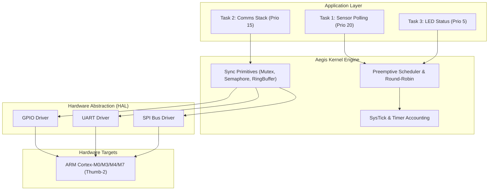

# Aegis Embedded RTOS

<div align="center">

```
   █████╗ ███████╗ ██████╗ ██╗███████╗    ██████╗ ████████╗ ██████╗ ███████╗
  ██╔══██╗██╔════╝██╔════╝ ██║██╔════╝    ██╔══██╗╚══██╔══╝██╔═══██╗██╔════╝
  ███████║█████╗  ██║  ███╗██║███████╗    ██████╔╝   ██║   ██║   ██║███████╗
  ██╔══██║██╔══╝  ██║   ██║██║╚════██║    ██╔══██╗   ██║   ██║   ██║╚════██║
  ██║  ██║███████╗╚██████╔╝██║███████║    ██║  ██║   ██║   ╚██████╔╝███████║
  ╚═╝  ╚═╝╚══════╝ ╚═════╝ ╚═╝╚══════╝    ╚═╝  ╚═╝   ╚═╝    ╚═════╝ ╚══════╝
```

**Next-Generation Safe-Language Firmware Kernel & Micro-OS for Microcontrollers in Rust (`#![no_std]`)**

[](https://github.com/ER-brocode/aegis-embedded-rtos/actions)
[](https://arm.com)
[](https://doc.rust-lang.org/edition-guide/rust-2021/no-std.html)
[](LICENSE)

</div>

---

## ⚡ Overview

**Aegis RTOS** is a memory-safe, preemptive priority-based real-time operating system kernel engineered specifically for low-power, safety-critical microcontrollers. Built strictly around Rust's zero-cost abstraction and `#![no_std]` model, Aegis delivers deterministic microsecond latency, zero heap fragmentation, and hardware abstraction layer (HAL) drivers conforming to `embedded-hal` v1.0.



---

## 🚀 Key Architectural Features

### 1. Preemptive Priority Scheduler
- **Deterministic Scheduling:** Guarantees strict preemptive execution order where highest priority tasks preempt immediately.
- **Round-Robin Fair Time-Slicing:** Tasks sharing identical priority levels execute in round-robin succession.
- **Zero Dynamic Allocation:** 100% statically allocated Task Control Blocks (TCB) preventing heap exhaustion and memory fragmentation.

### 2. Interrupt-Safe Synchronization Primitives
- **Lock-Free SPSC Ring Buffer:** Atomic Single-Producer Single-Consumer buffer tailored for low-latency ISR-to-Thread data streaming without disabling interrupts.
- **RAII Mutex:** Critical section guarded mutual exclusion preventing data races and priority inversion.
- **Semaphores:** Bounded counting and binary semaphores with atomic CAS operations.

### 3. Modular Hardware Abstraction Layer (HAL)
- **GPIO:** Full stateful output, floating input, and pull-up/pull-down modes compatible with `embedded-hal::digital`.
- **UART:** Double-buffered serial transmitter and receiver with zero-overhead interrupt hooks.
- **SPI:** High-speed full-duplex master bus engine implementing `embedded-hal::spi::SpiBus`.

---

## 📁 Repository Structure

```
aegis-embedded-rtos/
├── .github/
│   └── workflows/
│       └── ci.yml               # Automated multi-target CI pipeline
├── examples/
│   └── blinky_telemetry.rs      # Blinky + Telemetry task demonstration
├── src/
│   ├── hal/                     # Hardware Abstraction Layer
│   │   ├── gpio.rs              # GPIO digital input/output driver
│   │   ├── mod.rs               # HAL exports
│   │   ├── spi.rs               # SPI master bus driver
│   │   └── uart.rs              # Interrupt-driven UART driver
│   ├── kernel/                  # RTOS Core
│   │   ├── arch.rs              # Architecture context switching (Cortex-M & Mock)
│   │   ├── context.rs           # Stack frame & register context layout
│   │   ├── mod.rs               # Kernel exports
│   │   ├── scheduler.rs         # Preemptive priority task scheduler
│   │   └── time.rs              # SysTick timer accounting
│   ├── sync/                    # Concurrency & Synchronization
│   │   ├── mod.rs               # Sync exports
│   │   ├── mutex.rs             # Critical section Mutex & Guard
│   │   ├── ring_buffer.rs       # Lock-free SPSC Ring Buffer
│   │   └── semaphore.rs         # Counting & Binary Semaphore
│   └── lib.rs                   # Top-level crate exports
├── tests/
│   └── scheduler_tests.rs       # Complete unit & context switch tests
├── Cargo.toml                   # Project dependencies and targets
└── README.md                    # Project documentation
```

---

## 💻 Quickstart

### Adding to your Cargo.toml

```toml
[dependencies]
aegis-rtos = { git = "https://github.com/ER-brocode/aegis-embedded-rtos.git" }
```

### Spawning Tasks

```rust
#![no_std]
#![no_main]

use aegis_rtos::kernel::scheduler::{Scheduler, TaskPriority};
use aegis_rtos::kernel::arch::CortexMArch;

static mut TASK1_STACK: [u8; 1024] = [0; 1024];

extern "C" fn task_worker(_arg: usize) -> ! {
    loop {
        // Task logic
    }
}

#[entry]
fn main() -> ! {
    let mut sched = Scheduler::<CortexMArch>::new();

    unsafe {
        sched.spawn(TaskPriority::HIGH, &mut TASK1_STACK, task_worker, 0).unwrap();
    }

    loop {
        sched.on_systick();
        sched.switch_context();
    }
}
```

---

## 🧪 Testing

Run host-side unit tests and mocked scheduler context switches:

```bash
cargo test --features std
```

Target compilation for ARM Cortex-M:

```bash
cargo build --target thumbv7m-none-eabi --no-default-features --features cortex-m-arch
```

---

## 🛡️ License

Dual-licensed under either of:
- Apache License, Version 2.0 ([LICENSE-APACHE](LICENSE-APACHE))
- MIT License ([LICENSE-MIT](LICENSE-MIT))
